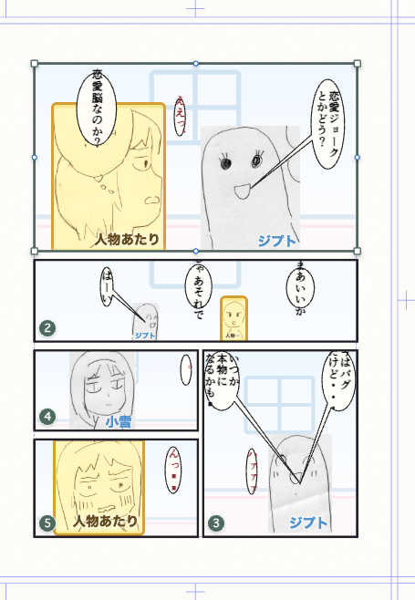
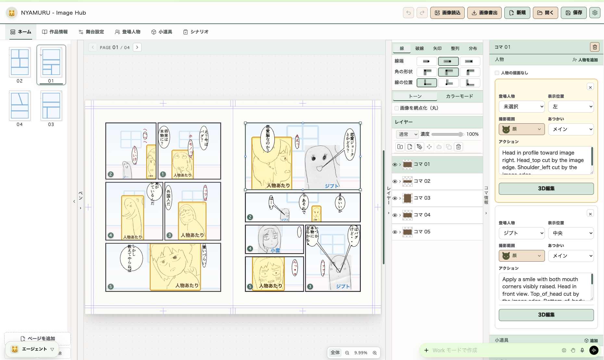
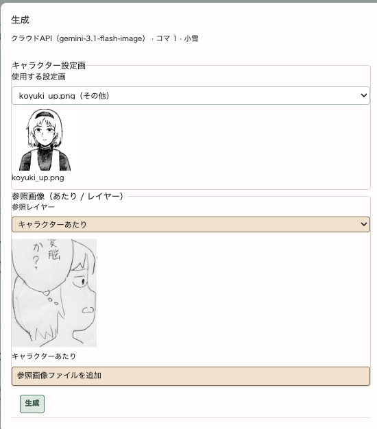
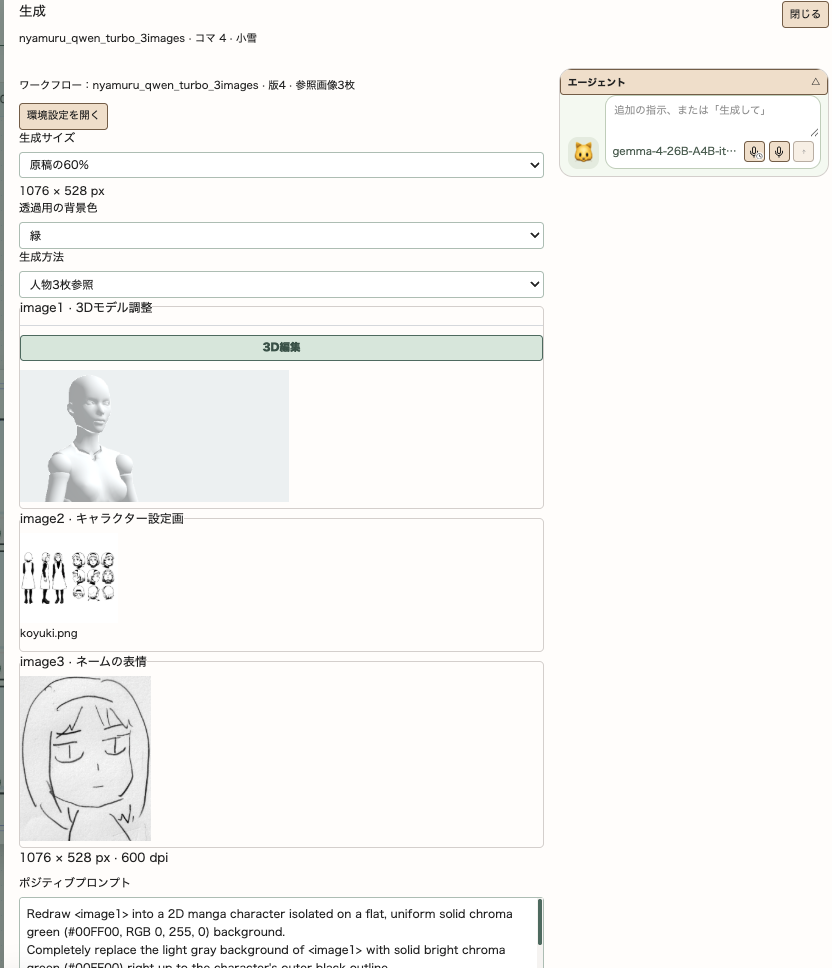
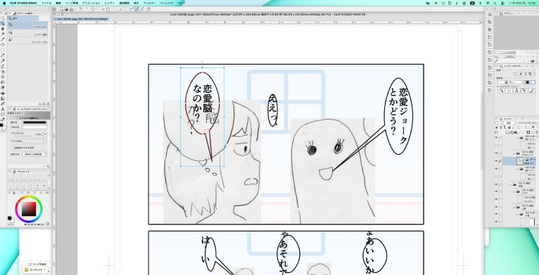

# Nyamuru 🐱 Image Hub

**紙のネームから、一貫性のある作画、クリスタでの仕上げまでをひとつにつなぐ漫画制作アプリ。**

[Nyamuru Manga Name Studio](https://github.com/sa-san10/nyamuru-manga-name-studio) を土台に、アナログネームの取り込み、キャラクター管理と作画支援、CLIP STUDIO PAINT（`.clip`）書き出しを備えたローカルファーストの制作ツールです。

| 紙のネーム | 取り込み・編集画面 |
|---|---|
|  |  |

▶ [取り込みから編集までの操作動画（約49秒・MOV）](./sample/sample.mov)

---

## Nyamuruの3つの特徴

### 1. ローカルOCRが強い — 紙のネームをそのまま編集できるデータに

紙に描いたネームを読み込むだけで、**文字・ふきだし・コマ**を自動で拾い上げ、すぐ編集できる状態に変換します。

- スキャン画像や写真から、コマ枠・人物あたり・ふきだし・セリフを一括で解析
- 解析はすべて手元のPC（ローカル）で完結するため、原稿を外部に送らず安心して利用可能
- 原画と見比べながら、文字の修正・ふきだしの調整・コマ割りの編集をそのまま進められます

---

### 2. キャラクターと設定画を自動で紐づけ — 一貫性のある生成がとても楽

登場キャラクターとキャラクターデザイン（設定画）をシリーズ単位で管理し、**コマ内の人物とデザイン資料を紐づけて生成できます**。

- 基本は **「キャラクター設定画」＋「キャラクターあたり（または3Dポーズ）」の2画像生成**。設定画とあたりが既定でセットされるため、細かいプロンプトの流し込みや英訳なしで一貫性のある作画を生成できます
- 生成先は **ComfyUI（ローカル）**・**クラウドAPI（ページ一括／単画像）**・**クラウドエージェント** に対応しています（[動作デモ（X）](https://x.com/yukin_co/status/2122997865748525187?a=K4-ZwDRRZ-SbirdKNEA&s=20)）
- 生成画像は元のあたりを消さず新規レイヤーとして最上段へ重なり、比較ややり直しも安心です（クラウドAPI単画像生成では送信後に編集画面へ戻り、完了時に自動配置＋あたり自動非表示まで行います）
- ネームの人物と登録キャラを自動で照合する **ビジョン機能（キャラ照合）** はオプション（既定OFF）で、ONにするとローカル（学習済み軽量画像エンコーダ／VLM）またはクラウドVision APIから選べます

オプション：3Dポーズ参照と部分修正（3画像）

- 3Dモデルでポーズやカメラアングルを決めた画像を、2画像生成の参照枠としてそのまま使えます。
- 生成後のピンポイントな手直しには、**部分修正用の3画像構成（元絵＋修正マスク／赤入れ＋キャラクター設定画）** を使用します。

| 3Dモデルでポーズと構図を決める | 部分修正・参照イメージ |
|---|---|
|  |  |

---

### 3. レイヤー構造やマスク情報を保ったままクリスタに送れる

Nyamuruで整えたページは、**レイヤー構造やマスク情報を保ったまま CLIP STUDIO PAINT 形式（`.clip`）で書き出せます**。

- コマ枠、ふきだし、文字、描画、生成画像、原本などが階層を保ったまま出力されます
- 1枚絵に統合されないため、クリスタ側でそのまま文字の修正・線の描き込み・マスクの調整が可能です
- ネーム〜作画の土台づくりはNyamuru、仕上げ・清書はクリスタ、と制作フローを自然につなげられます

---

## 操作動画

- [人物設定から作画を組み立てる（X）](https://x.com/yukin_co/status/2117238094068084793)
- [ふきだしアセットを使う（X）](https://x.com/yukin_co/status/2117425677435867287)
- [ポーズアセットを使う（X）](https://x.com/yukin_co/status/2108575800270508059)

## はじめ方（セットアップ）

セットアップや起動の手順・技術構成はすべて [AGENTS.md](./AGENTS.md) にまとめています。
お使いのAIエージェント（Codex・Antigravity・Claude Code など）に **「`AGENTS.md` を読んでセットアップして起動して」** と依頼して進めてください。

詳しい操作方法を知りたい場合は [使い方ガイド](./docs/USAGE.md) も参照できます。

## 作者・ライセンス

本プロジェクトは [sa-san10/nyamuru-manga-name-studio](https://github.com/sa-san10/nyamuru-manga-name-studio) を基にしたフォークです。Nyamuru本体およびこのフォークで追加したコード・文書は、個別に別の表示があるものを除き [MIT License](./LICENSE) で提供します。

第三者コンポーネントのライセンスは [外部コンポーネントとライセンス](./docs/LOCAL_VISION_COMPONENTS.md) および [THIRD_PARTY_NOTICES.txt](./public/THIRD_PARTY_NOTICES.txt) を参照してください。
