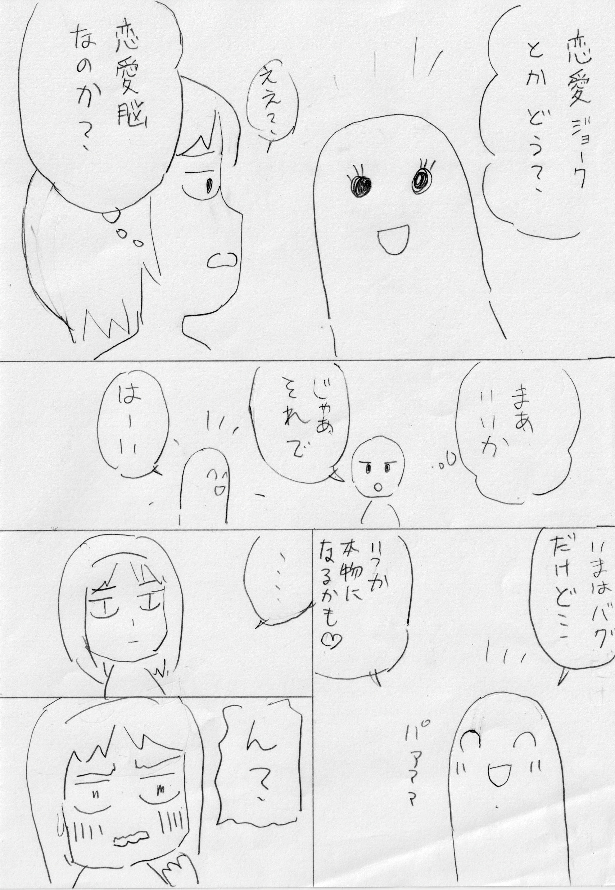
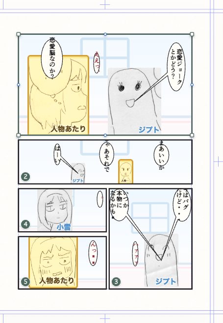
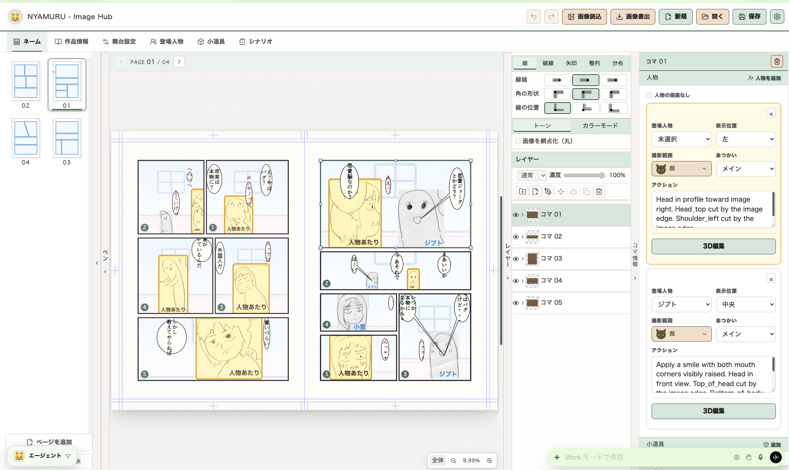
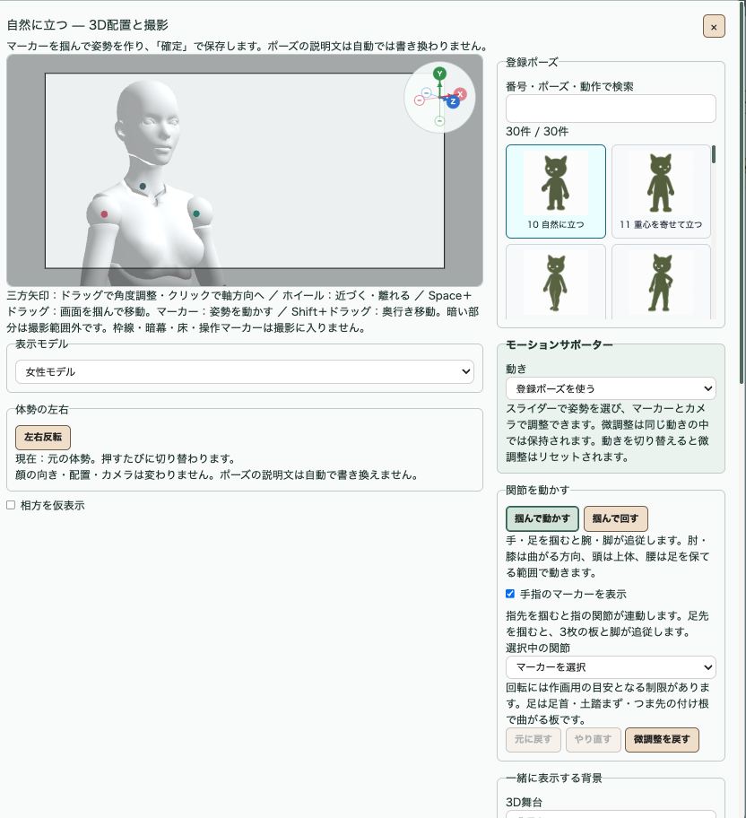
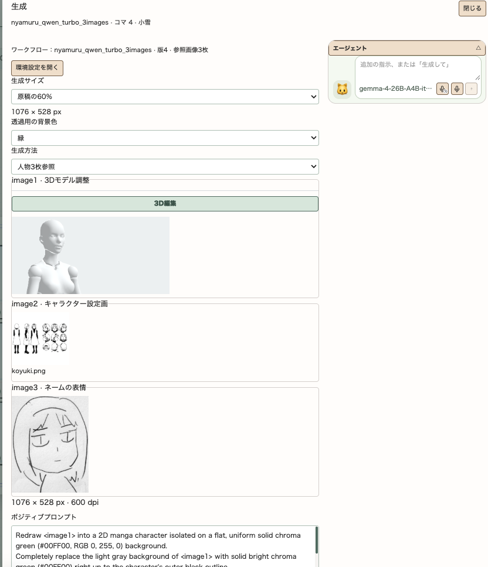

# Nyamuru 🐱 Image Hub

[](./LICENSE)

紙のネームや視覚資料を解析し、編集可能な漫画設計へつなぐローカルアプリです。

[本家 Nyamuru Manga Name Studio](https://github.com/sa-san10/nyamuru-manga-name-studio) のOMNY編集・生成プロンプト機能に、アナログネームの取り込みとコマ編集支援を追加しています。

## できること

- スキャン画像や画像ファイルから、コマ・人物アタリ・フキダシを検出
- 手書き文字を読み取り、アタリとしてフキダシへ配置
- 検出結果を原画と見比べながら修正し、OMNY形式で保存
- シリーズごとの人物設定と複数のデザイン資料画像をローカル台帳へ保存
- 明示的に選んだ人物資料1枚から、照合用の外見特徴候補をローカルVLMで抽出
- 内枠スナップ、コマスナップ、Shift移動、コマ合体などでコマを調整
- ネーム上へ通常文字を自由配置し、PC内フォントや吹き出し素材で編集
- 舞台設定の各背景へGLB／FBXを紐づけ、シリーズ内で管理コピーを再利用
- Nyamuru本来のネーム編集、生成プロンプト、OMAY連携を利用

※ モノクロ300dpi程度だとかなり高精度で読み取れます。

## アナログネーム取り込み例

| 原画 | 解析結果 |
|---|---|
|  |  |

▶ [取り込みから編集開始までの操作動画（約49秒・MOV）](./sample/sample.mov)

## 編集画面と人物生成



原稿を見ながら、読み取ったセリフや人物あたりをコマごとに調整できます。

### 3枚の参照画像から人物を生成する

| 3Dモデルのポーズと撮影範囲を決める | 3枚の参照画像とプロンプトを確認する |
|---|---|
|  |  |

「3D編集」にはポーズアセットが複数登録。アセットから詳細なポーズやカメラ位置の変更が可能です。**モーションサポーター**では、動きを再生したり、スライダーで使いたい瞬間を選んだりできます。

生成画面の「人物3枚参照」では、それぞれの画像が別の役割を持ちます。

| 参照画像 | 生成に使う情報 |
|---|---|
| image1 · 3Dモデルの撮影画像 | ポーズ・カメラの向き・画面に収める範囲 |
| image2 · キャラクタービジュアル設定画 | 髪・衣装など、人物の外見や絵柄 |
| image3 · ネームから切り出した人物あたり | そのコマの表情や感情 |

人物設定や撮影範囲に合わせて英語の生成プロンプトを自動で組み立てます。プロンプトは必要に応じて書き直してください。

### 操作動画

- [人物設定からプロンプトを組み立てる（X）](https://x.com/yukin_co/status/2117238094068084793)
- [ふきだしアセットを使う（X）](https://x.com/yukin_co/status/2117425677435867287)
- [ポーズアセットを使う（X）](https://x.com/yukin_co/status/2108575800270508059)

## 起動

Node.js 22.12.0以上が必要です。初回だけ、このリポジトリのフォルダで依存を導入します。

```bash
npm ci
```

起動コマンドは、画像生成に使うパソコンで実行します。

| 編集する場所 | 起動コマンド |
|---|---|
| 画像生成に使うパソコンで直接編集する | `npm run dev` |
| 別のパソコンからLAN経由で編集する | `npm run lan` |

`npm run dev` は、にゃむるの開発サーバーを起動します。`dev` と `lan` は、画像解析などを使うときにローカル連携サービス（bridge）を自動で起動します。`npm run bridge` は、bridge単体の動作確認に使います。

LANでは、起動画面に表示された `https://` のアドレスを編集PCで開きます。初回の証明書登録は [別のPCから使う手順](./docs/LAN_EDITING.md) を参照してください。文章AIを使う場合は、画像生成に使うパソコンで、普段使う文章AIも先に起動しておきます。

終了するときは作品を保存し、起動したターミナルで `Ctrl+C` を押します。

「画像書出」から、ページをPNG・統合PSD・編集用CLIPで保存できます。CLIPを使うときは、にゃむるを起動するPCで初回の変換器準備を済ませてください。[書き出し操作と初回準備](./docs/USAGE.md#ページを画像に書き出す)

アナログネーム取り込みを使う場合は、初回だけ画像解析環境を準備します。

```bash
npm run setup:vision
```

以後は用途に応じて `npm run lan` または `npm run dev` で起動します。「新規作成」を開くとローカル画像解析が自動で起動し、作成完了またはキャンセル時に自動で終了します。

`npm run dev` の文章処理は8080で起動済みのローカルMLXサーバーを自動で共用します。未起動の場合は環境設定のモデルを必要な間だけ起動します。画像生成ではプロンプトを英訳して保存し、文章LLMを一時停止してからComfyUIを起動します。生成に使ったComfyUIプロセスの終了後、元から起動していたLLMを同じ設定で復帰します。共有LLMの自動復帰にはmacOSまたはLinuxと、同じユーザーで起動されたサーバーが必要です。

詳しい操作とセットアップは [使い方ガイド](./docs/USAGE.md) を参照してください。

## 別のPCから使う

LAN機能を使えば、ローカルAIが動かない古いパソコンでも、ブラウザーで漫画を編集できます（OS X El Capitanで動作確認済み）。

[接続から保存・終了までの手順](./docs/LAN_EDITING.md) を順番に進めてください。初回の準備もこのページにまとめています。

## ドキュメント

- [使い方](./docs/USAGE.md)
- [別のPCから使う手順](./docs/LAN_EDITING.md)
- [このフォークの機能と既知の制限](./docs/FORK_FEATURES.md)
- [ローカル画像解析の詳細](./docs/LOCAL_VISION_BRIDGE.md)
- [シリーズ人物資料と照合特徴](./docs/SERIES_CHARACTER_CATALOG.md)
- [外部コンポーネントとライセンス](./docs/LOCAL_VISION_COMPONENTS.md)
- [本家更新の取り込み方](./docs/UPSTREAM_SYNC.md)
- [変更履歴](./docs/FORK_CHANGELOG.md)

## 作者・ライセンス

本プロジェクトは [sa-san10/nyamuru-manga-name-studio](https://github.com/sa-san10/nyamuru-manga-name-studio) を基にしたフォークです。Nyamuru本体と、このフォークで追加したコード・文書は、個別に別の表示があるものを除き [MIT License](./LICENSE) で提供します。

RT-DETRモデル、Baberu OCR、その他の第三者コンポーネントには、それぞれのライセンスが適用されます。詳しくは [外部コンポーネントとライセンス](./docs/LOCAL_VISION_COMPONENTS.md) および [THIRD_PARTY_NOTICES.txt](./public/THIRD_PARTY_NOTICES.txt) を参照してください。

## ローカル配置

画像生成に使うパソコンで直接編集する場合は、リポジトリのフォルダーで `npm run dev` を実行します。別のパソコンから編集する場合は、同じフォルダーで `npm run lan` を実行します。モデルと既存依存は `.local-vision/` を使用し、VLMは兄弟の `ComfyUI/.venv` を引き続き利用します。

既存作品との互換性のため、保存キー、NDM名、`NYAMURU_*` 環境変数、内部保存先・サービス識別子は維持しています。著作権と第三者クレジットは `LICENSE` とライセンス画面を参照してください。

## 操作分類モデル

採用済みのModernBERT分類器は、clone後に `npm run setup:vision` を実行すると、このリポジトリのReleaseから重み約147MBを取得し、`models/nyamuru-voice-v04-seed43/` に保存・検証します。以後の分類は本体内のモデルで動作します。[導入と検証](docs/2026-10-24-classifier-bundle.md)・[精度改善の手順と研究記録](docs/ModernBERT/README.md)。
