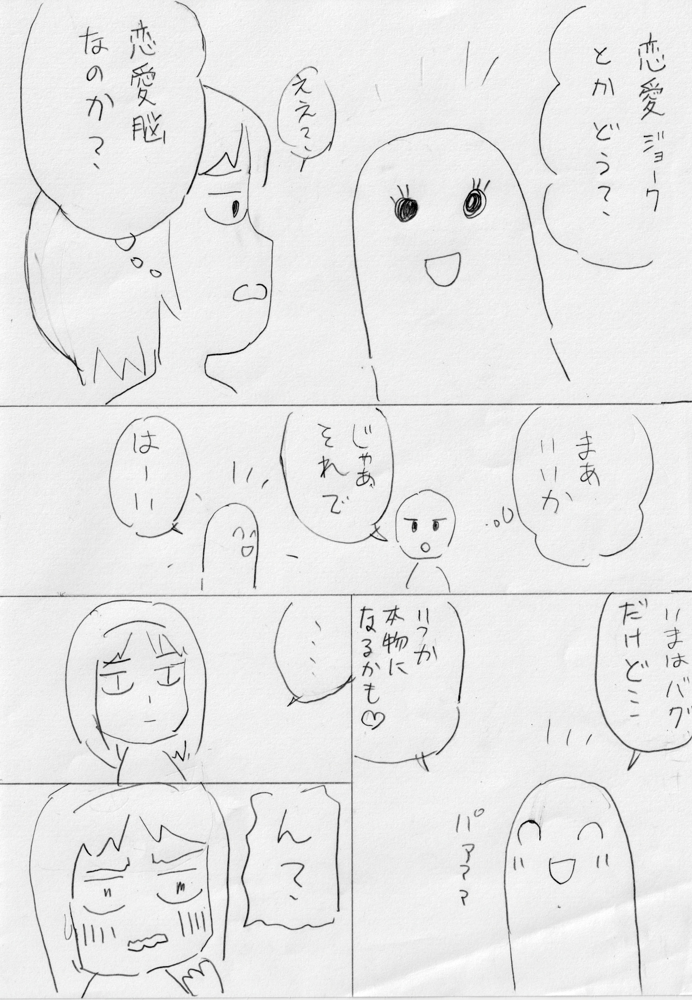
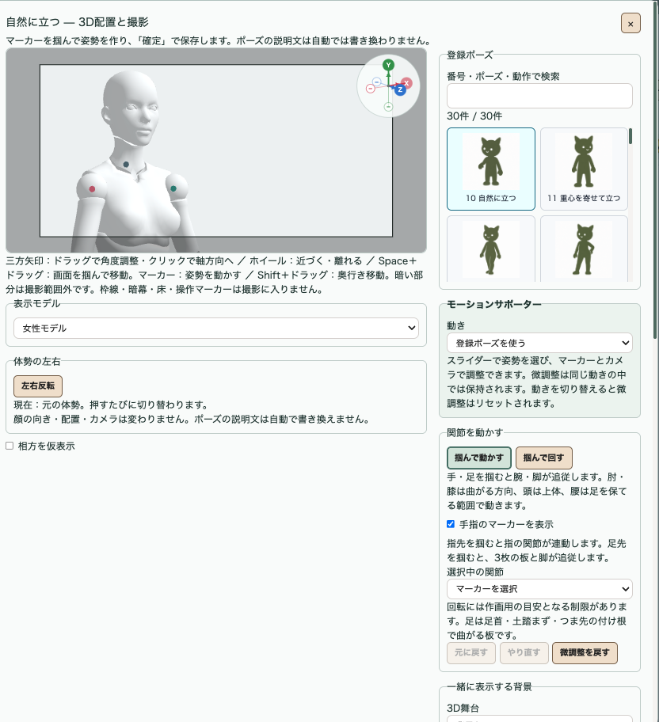

# Nyamuru 🐱 Image Hub

[](https://github.com/yukincom/nyamuru-image-hub/actions/workflows/ci.yml)
[](./LICENSE)

**紙のネームを、編集できる漫画制作データへ。**

Nyamuru Image Hubは、アナログネームの取り込みからコマ・人物・文字の編集、ローカルAIを使った作画支援までをひとつにつなぐ、ローカルファーストの漫画制作アプリです。

[Nyamuru Manga Name Studio](https://github.com/sa-san10/nyamuru-manga-name-studio) のOMNY編集・生成プロンプト機能を土台に、原稿解析、レイヤー編集、人物資料、3Dポーズ、文字組み、ComfyUI画像生成、LAN編集を追加しています。

## アナログネーム取り込み例

| 紙の原画 | 解析・編集結果 |
|---|---|
|  |  |

▶ [取り込みから編集までの操作動画（約49秒・MOV）](./sample/sample.mov)

解析結果は完成データではなく、原画を見ながらすぐ編集を始めるための土台です。

## Nyamuruでできること

### 紙のネームから編集画面までを自動でつなぐ

- 画像ファイルまたはmacOSのスキャナーから、最大10ページをまとめて取り込み
- RT-DETRとBaberu OCRで、コマ・人物・文字領域をローカル解析
- 各ページの人物照合、姿勢・向き・表情の読み取り、作品作成までを順に実行
- 「解析開始」から全ページを処理し、そのまま編集画面へ移動
- 原画と解析結果を見比べながら、誤読や位置を人の手で修正

### 漫画制作向けの編集機能

- コマ、人物、背景、フキダシ、写植、描き文字をレイヤーで管理
- 内枠・コマ間隔へのスナップ、辺・頂点編集、Shift移動、コマ合体
- レイヤー追加・並べ替え・ロック・表示切替とUndo／Redo
- PC内フォント、フキダシ素材、縦横の文字組み、描き文字のペン・表現を編集
- 生成画像は元のあたりを消さず、同じ対象フォルダーの最上段へ新規レイヤーとして追加

### 人物を作品のあいだで育てる

- 「シリーズ共通」と「この話だけ」の人物を分けて管理
- 人物像、基準頭身、複数のデザイン資料、採用済みの外見特徴をシリーズ台帳へ保存
- 選んだ設定画1枚から、人間・人外・マスコットの外見特徴をローカルVLMで抽出
- ネームの顔を同梱の表情辞書と照合し、眉・目・口・漫符を含む生成用の表情文を作成
- 抽出した候補は自動確定せず、生成前に確認・修正

### 3DとローカルAIで作画を支援

- 3D人体のポーズ、指・足先、モーション、カメラ、撮影範囲を編集して構図資料に利用
- GLB／FBX背景を舞台設定へ登録し、シリーズ内で再利用
- 人物生成では、①ネームの表情、②設定画の外見、③3Dのポーズを役割の異なる3枚の参照として使用
- 1回の生成で5候補を比較し、透過済みの候補から採用分を選んでコマまたはマスクに合わせて配置
- ComfyUIのAPIワークフローを環境設定から登録・選択
- 文章LLMと画像生成の起動・停止を調整し、限られたローカルメモリを共用

### 原稿もAI処理も手元に置く

- 原稿解析、VLM、文章処理、画像生成は標準構成ではローカルで実行
- LAN機能を使えば、ローカルAIが動かない古いパソコンでも、ブラウザーで漫画を編集できます（OS X El Capitanで動作確認済み）。
- 作品は編集PCで選んだフォルダーへ保存
- モデル、原稿、生成ジョブはGitリポジトリへ含めない

## 処理の流れ

1. 原稿画像を選ぶか、スキャナーから取り込みます。
2. ページの向きとコマ間隔を確認して「解析開始」を押します。
3. 全ページのコマ・人物・文字が解析され、編集画面が開きます。
4. コマ、レイヤー、フキダシ、文字、人物設定を修正します。
5. 必要に応じて3D資料やローカルAI生成を使い、採用結果を新規レイヤーへ追加します。
6. OMNYまたは作品フォルダーへ保存します。

## 編集画面と人物生成


原稿を見ながら、読み取ったセリフや人物あたりをコマごとに調整できます。

### 3枚の参照画像から人物を生成する

| 3Dモデルのポーズと撮影範囲を決める | 3枚の参照画像とプロンプトを確認する |
|---|---|
|  |  |

「3D編集」にはポーズアセットが複数登録。アセットから詳細なポーズやカメラ位置の変更が可能です。**モーションサポーター**では、動きを再生したり、スライダーで使いたい瞬間を選んだりできます。

生成画面の「人物3枚参照」では、それぞれの画像が別の役割を持ちます。

| 参照画像 | 生成に使う情報 |
|---|---|
| image1 · 3Dモデルの撮影画像 | ポーズ・カメラの向き・画面に収める範囲 |
| image2 · キャラクタービジュアル設定画 | 髪・衣装など、人物の外見や絵柄 |
| image3 · ネームから切り出した人物あたり | そのコマの表情や感情 |

人物設定や撮影範囲に合わせて英語の生成プロンプトを自動で組み立てます。プロンプトは必要に応じて書き直してください。

### 操作動画

- [人物設定からプロンプトを組み立てる（X）](https://x.com/yukin_co/status/2117238094068084793)
- [ふきだしアセットを使う（X）](https://x.com/yukin_co/status/2117425677435867287)
- [ポーズアセットを使う（X）](https://x.com/yukin_co/status/2108575800270508059)

## 起動

Node.js 22.12.0以上が必要です。初回だけ、このリポジトリのフォルダーで依存を導入します。

```bash
npm ci
```

起動コマンドは、画像生成に使うパソコンで実行します。

| 編集する場所 | 起動コマンド |
|---|---|
| 画像生成に使うパソコンで直接編集する | `npm run dev` |
| 別のパソコンからLAN経由で編集する | `npm run lan` |

`npm run dev` は、にゃむるの開発サーバーを起動します。`dev` と `lan` は、画像解析などを使うときにローカル連携サービス（bridge）を自動で起動します。`npm run bridge` は、bridge単体の動作確認に使います。

LANでは、起動画面に表示された `https://` のアドレスを編集PCで開きます。初回の証明書登録は [別のPCから使う手順](./docs/LAN_EDITING.md) を参照してください。

終了するときは作品を保存し、起動したターミナルで `Ctrl+C` を押します。

「画像書出」から、ページをPNG・統合PSD・編集用CLIPで保存できます。CLIPを使うときは、にゃむるを起動するPCで初回の変換器準備を済ませてください。[書き出し操作と初回準備](./docs/USAGE.md#ページを画像に書き出す)

## ローカル解析とAI機能の準備

アナログネーム取り込みを使う場合は、初回だけ画像解析環境を準備します。

```bash
npm run setup:vision
```

| 機能 | 主なローカル構成 |
|---|---|
| コマ・人物・文字領域の解析 | RT-DETR、OpenCV、Baberu OCR |
| 人物・姿勢・表情・設定画の読み取り | Qwen3-VL／MLX |
| 文章処理と生成プロンプト | ローカルMLXサーバー |
| 画像生成 | ComfyUI、Qwen Image 2.1 Turbo対応ワークフロー |
| 操作分類 | 同梱のModernBERT tokenizerとRelease配布の重み |

`npm run dev` は、8080で起動済みのローカルMLXサーバーを自動で共用します。画像生成ではプロンプトを英訳して保存し、必要に応じて文章LLMを一時停止してComfyUIを使用します。生成処理の終了後は、元から起動していたLLMを同じ設定で復帰します。

詳しい準備と操作は [使い方ガイド](./docs/USAGE.md) を参照してください。

## 現在の制限

- 手書きOCRは画像品質や字形に左右されるため、原画を見ながらの修正を前提とします。
- 原稿の向きは解析前に人が確認します。自動回転は行いません。
- スキャナーの直接起動はmacOS専用です。
- 公開Webサイトからローカル解析bridgeを呼び出す構成はサポートしません。
- VLM・文章LLM・ComfyUIの機能には、対応するローカル環境とモデルが必要です。第三者モデルや一部の3D素材はリポジトリに同梱しません。
- 画像生成の品質と処理時間は、選んだComfyUIワークフロー、モデル、参照画像、実行環境に依存します。

## ドキュメント

- [使い方](./docs/USAGE.md)
- [別のPCから使う手順](./docs/LAN_EDITING.md)
- [このフォークの機能と既知の制限](./docs/FORK_FEATURES.md)
- [ローカル画像解析の詳細](./docs/LOCAL_VISION_BRIDGE.md)
- [シリーズ人物資料と照合特徴](./docs/SERIES_CHARACTER_CATALOG.md)
- [ComfyUIワークフロー接続仕様](./docs/COMFYUI_WORKFLOW_SPEC.md)
- [外部コンポーネントとライセンス](./docs/LOCAL_VISION_COMPONENTS.md)
- [本家更新の取り込み方](./docs/UPSTREAM_SYNC.md)
- [変更履歴](./docs/FORK_CHANGELOG.md)
- [ModernBERT分類器の導入と検証](./docs/2026-10-24-classifier-bundle.md)・[研究Release](https://github.com/yukincom/nyamuru-image-hub/releases/tag/nyamuru-modernbert-research-2026-10-24)

## 作者・ライセンス

本プロジェクトは [sa-san10/nyamuru-manga-name-studio](https://github.com/sa-san10/nyamuru-manga-name-studio) を基にしたフォークです。Nyamuru本体と、このフォークで追加したコード・文書は、個別に別の表示があるものを除き [MIT License](./LICENSE) で提供します。

RT-DETRモデル、Baberu OCR、その他の第三者コンポーネントには、それぞれのライセンスが適用されます。詳しくは [外部コンポーネントとライセンス](./docs/LOCAL_VISION_COMPONENTS.md) および [THIRD_PARTY_NOTICES.txt](./public/THIRD_PARTY_NOTICES.txt) を参照してください。
