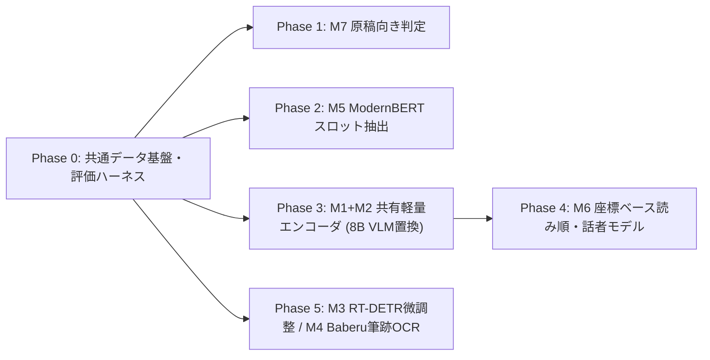

# Nyamuru 軽量専用モデル化計画書（グループ1・2・3）

- 作成日: 2026-11-25
- 対象リポジトリ: `Comic_image_Hub`
- 状態: **段階実装済み（グループ1〜3コード・推論枠組導入済み、M1 ONNX 学習済み重み導入まではビジョン既定 OFF・ローカル軽量エンコーダ実行先既定）**

## 1. 目的と設計原則

本計画書は、Nyamuru の処理速度やメモリ軽快さを損なわずに（あるいは既存の重い推論を置き換えて大幅に軽量化しつつ）、アナログネーム取り込み・キャラ照合・2画像生成準備・音声/文字操作の精度を引き上げるための **7つの軽量専用モデル（M1〜M7）** の設計と段階的導入計画を定める。

### 設計原則

1. **既存モデルの差し替え・ヘッド相乗りで追加コストをほぼゼロにする（グループ2）**
   すでに毎回動作している `rtdetrv4-x-manga109s_v2`・`baberu-ocr`・`ModernBERT` の重み差し替えまたは軽量ヘッド追加に留め、推論回数や常駐プロセスを増やさない。
2. **重い 8B VLM を 1つの共有軽量画像エンコーダへ置換する（グループ1）**
   従来は重いためオプション（既定 OFF）だったローカル 8B VLM（`Qwen3-VL-8B-Instruct-MLX-4bit`）の役割のうち、「キャラ照合」と「向き・撮影サイズ・最適設定画アングル判定」を1つの軽量エンコーダ＋2ヘッドへ蒸留・置換し、数GB・数秒〜十数秒の処理を数十〜数百MB・数十ms へ落とす。学習済み M1 ONNX 重みが未配置の間はビジョン既定 OFF かつ自動照合を安全棄却し、重み導入後に精度検証を経て既定 ON 化できる構成にする。
3. **新規追加は「座標数値のみ（<1ms）」と「縮小サムネイルのみ（5〜10ms）」に限定する（グループ3）**
   新規モデルを追加する場合も、画像を使わない表形式モデル（BBox 座標等の数値のみ）と取り込み時1回だけの極小サムネイル分類器に限定する。
4. **ComfyUI とのメモリ共存とローカル完結・再現性規約を守る**
   ローカル既定の画像生成（`P-H3-Image` 2画像参照・プロンプト流し込みなし）や ComfyUI とのメモリ共存を阻害しないよう、モデル重みは Git に含めず、既存の Release＋SHA-256 検証＋`provenance.json`＋オフライン実行（`HF_HUB_OFFLINE=1` / `TRANSFORMERS_OFFLINE=1`）の規約（[ModernBERT同梱記録](2026-10-24-classifier-bundle.md)・[ローカル画像解析](LOCAL_VISION_BRIDGE.md)）に統一する。また、2画像生成・プロンプト流し込み廃止・キャラ照合（ビジョン）既定 OFF 方針（[AGENT_MODEL_SPEC.md](AGENT_MODEL_SPEC.md)）と矛盾させない。

### 対象外（モデル化しない境界）

処理負荷増・メモリ競合・決定性の破壊を避けるため、以下は本計画から明確に除外する。

- **高解像度の Image-to-Image / セグメンテーション系**: 背景透過（クロマキー／白フラッドフィル）、仕上げレイヤー分離（線画・ベタ・トーン）、紙面クリーンアップ、3D背景線画の漫画化、隙間閉じバケツ塗り、1ページ生成のコマ/レイヤー分離。
- **ブラウザ内で 1ms 未満かつ決定的に動く処理**: 初期改行ヒューリスティック（`Intl.Segmenter`）、厳格シナリオ構文解析、ベジェ幾何・しっぽ結合、コマスナップ・内枠スナップ・コマシンクロ、`.clip` 書き出し、保存・手動ロック制御。
- **ComfyUI 直後のメモリ競合を起こす後段モデル**: 生成画像の意味的QAモデル、Whisper 後段の独立テキスト補正モデル、2D→3D 63関節直接回帰モデル。

---

## 2. 全体マップ（全7モデル・3グループ）

| ID | グループ | 対象機能・置換対象 | モデル種別 | 想定モデルサイズ | 目標推論時間（CPU / Apple Silicon） | メモリ増減（対現行） | 導入フェーズ |
|---|---|---|---|---|---|---|---|
| **M1** | G1（重い8B置換） | キャラ照合（`local_character_match_worker.py` の 8B VLM 置換） | 共有軽量画像エンコーダ＋埋め込み射影（Head 1） | M1+M2合計 80〜250MB（量子化 ONNX） | 15〜40ms / 人物 | **大幅減**（数GB → 百数十MB） | Phase 3 |
| **M2** | G1（重い8B蒸留） | キャラ向き・撮影サイズ・最適設定画アングル自動選択（`local_figure_performance_worker.py` 蒸留） | M1 と同一エンコーダ共有＋多タスク分類ヘッド（Head 2） | M1 と共有（＋数MBヘッド） | +1〜2ms（M1 と同時計算） | **大幅減**（単一推論に統合） | Phase 3 |
| **M3** | G2（既存差し替え） | RT-DETR アナログネーム微調整＋フキダシ種別/しっぽ拡張（`rtdetr_onnx.py`） | RT-DETRv4-X ONNX 微調整 | 現行同等（差し替え） | 現行同等（+0ms 相当） | **±0** | Phase 5 |
| **M4** | G2（既存差し替え） | Baberu OCR 自分の筆跡向け微調整（`local_vision_worker.py`） | Baberu OCR ONNX（LoRA 統合済み重み・ローカル専用） | 現行同等（差し替え） | 現行同等（+0ms 相当） | **±0** | Phase 5 |
| **M5** | G2（既存ヘッド追加） | ModernBERT 意図分類＋スロット抽出統合（`nyamuru_voice_intent.py`・`voiceCommands.ts`） | ModernBERT 19意図分類＋BIO トークン分類 | 現行約150MB（＋線形層数MB） | +1〜2ms（現行内） | **+数MB** | Phase 2 |
| **M6** | G3（座標数値のみ） | コマ読み順・話者紐づけ・`page_overlay` 判定（`nyamuru_layout_geometry.py`・`pageElements.ts`） | LightGBM / 小型 MLP（ONNX） | 0.5〜3MB | **1ms 未満 / ページ** | **ほぼ0** | Phase 4 |
| **M7** | G3（極小サムネのみ） | 原稿の向き自動判定 0/90/180/270°（`nyamuru_ocr_util.py`） | 超軽量 CNN（MobileNetV3-Small / ConvNeXt-Tiny 級 ONNX） | 3〜10MB | 5〜10ms / ページ | **+20〜40MB（一時）** | Phase 1 |

---

## 3. 共通基盤（Phase 0）：データフライホイール・学習・評価・配布規約

モデル単体を個別に作るのではなく、**「普通に漫画を描くだけで教師データが貯まり、オフライン検証を経て安全に差し替えられる」** 共通基盤を先に整える。

### 3.1 ローカル教師データ自動蓄積（Data Flywheel）

Nyamuru は「自動解析 → 人間が直して完成させる」構造を持つため、作品保存データ（`.nyamuru/project.json`）と取り込み時メタデータの差分から以下の教師データをローカル専用領域へ自動抽出できる。

| 普段の編集操作 | 抽出元データ | 生成される教師データ | 活用先 |
|---|---|---|---|
| OCR の誤読を修正する | `analogTextImport` の原画切り抜き × 確定した `bubble.text` | `(文字領域クロップ画像, 正解文字列)` | **M4**（筆跡 OCR） |
| フキダシ形状を変更する | `analogTextImport` 周辺画像 × 確定した `bubble.shape` | `(フキダシ領域画像, 形状クラス)` | **M3**（フキダシ種別） |
| コマ枠・人物あたりを直す | 取込原画 × 確定した `panel.shape` / `figure.bbox` | `(原画, 修正後 BBox/クラス)` | **M3**（ネーム検出）、**M6**（読み順・飛び出し） |
| 人物にキャラを割り当てる | `analogImport` の人物クロップ × 確定 `figure.refId` | `(ネーム人物クロップ, 設定画群, 正解キャラID)` | **M1**（キャラ照合） |
| 生成時に設定画アングルを選ぶ | `analogImport` の人物クロップ × 選択された `CHARACTER_REFERENCE_VIEWS` / `size` | `(人物クロップ, view/facing/size)` | **M2**（アングル自動選択） |
| 音声・文字コマンドが弾かれた | 音声認識ログ／入力テキスト × 実行コマンド | `(発話テキスト, 意図ラベル, スロットスパン)` | **M5**（意図＋スロット） |

**プライバシーとデータ境界**:
- 抽出データセットは Git 管理外の専用ローカル領域（例: `dev_tools/datasets/` または `~/.nyamuru/training_data/` 配下の明示ディレクトリ）のみに保存し、Git リポジトリや公開配布物へ絶対に含めない。
- ユーザーの原稿・個人筆跡データを外部サーバーへ送信したり、許可なく自動学習バックグラウンドジョブを走らせたりしない（学習スクリプトは明示実行のみ）。

### 3.2 合成データと知識蒸留の活用

手作業ラベル付けを最小化するため、既存資産から教師データを半自動生成する。

- **3D人体リグ（`scripts/human_pose/`）**: 63関節・カメラ角度・サイズ（`FIGURE_PERFORMANCE_SIZES`）の完全な正解値を持つため、輪郭抽出＋ラフ線画劣化フィルタを通したレンダリング画像を大量生成し、**M2** の向き・サイズ学習に使う。
- **設定画の線画劣化合成**: 登録済みキャラクター設定画（`front / three-quarter / side / back` 等）に対し、線画抽出・アスペクト揺らぎ・省略（顔簡略化・鉛筆ノイズ）を加えて疑似ネームクロップを作り、**M1** の Metric Learning 用ペアを補う。
- **既存 8B VLM / クラウド Vision からの蒸留**: 8B VLM（`local_figure_performance_worker.py`）をオフラインバッチで走らせ、構造化出力（`VIEW_ANGLES`, `HORIZONTAL_FACING`, `FIGURE_PERFORMANCE_SIZES`）を疑似ラベルとして **M2** に蒸留する。
- **原稿の90°単位回転合成**: 既存スキャン・完成ページを 0/90/180/270° 回転するだけで、**M7** の学習データは即座に 4 倍確保できる。

### 3.3 学習・配置・配布・ロールバック契約

- **学習コードの分離**: 学習・蒸留・ベンチマーク用スクリプトは `dev_tools/` 配下に閉じ込め、アプリ本体（`src/`・`scripts/` のランタイム）へ学習依存（`accelerate`, `peft`, `lightgbm` 学習側等）を持ち込まない。
- **推論ランタイムの統一**: 本番推論は原則 **ONNX Runtime（CPU / CoreML EP）** または既存の `transformers` オフライン構成（`.local-vision/.venv`）で完結させ、新規 Python 仮想環境を増やさない。
- **重みの配布区分**:
  - **公開配布モデル（M1+M2, M3汎用, M5, M6, M7）**: 重みは Git に含めず、GitHub Release＋`setup-local-vision.mjs` / `install_voice_intent.py` の SHA-256 検証＋`provenance.json`＋基礎モデル LICENSE 同梱で導入する。
  - **個人専用モデル（M4 個人筆跡 OCR、任意で M3 個人ネーム特化）**: 筆跡・絵柄の保護および一般ユーザーへの適合性のため **ローカル専用（非配布）** とし、差し替え先パス（環境変数または `.local-vision/models/` のローカル上書き枠）を契約化する。
- **ロールバック**: すべてのモデルは設定または重みファイル有無で旧実装（ルールベース / 既定 ONNX 重み / 8B VLM）へ即時フォールバックできる構造を維持する。

### 3.4 性能・メモリ予算（全体ガードレール）

| 指標 | 目標予算 |
|---|---|
| 1ページ取り込みあたりの追加推論時間（M7 + M6 + M1/M2） | 合計 **150ms 以内**（人物5名想定） |
| 新規追加モデルによるピーク RSS 増加（M5差分 + M6 + M7） | **+60MB 以内** |
| 共有エンコーダ（M1+M2）の推論時ピーク RSS | **600MB 以内**（従来の 8B VLM 数GB から大幅削減） |
| ComfyUI 画像生成開始時 | `M1〜M7` のモデルメモリは解放済みまたは ComfyUI（`P-H3-Image`）と競合しない範囲（合計物理メモリ余裕を確保） |

---

## 4. 各モデル詳細設計（M1〜M7）

### グループ1：既存の重い 8B VLM を置換する共有エンコーダ（M1＋M2）

#### 現状と課題
- 従来の [local_character_match_worker.py](../scripts/local_character_match_worker.py) と [local_figure_performance_worker.py](../scripts/local_figure_performance_worker.py) は `Qwen3-VL-8B-Instruct-MLX-4bit`（数GB・数秒〜十数秒）に依存していたため、[AGENT_MODEL_SPEC.md](AGENT_MODEL_SPEC.md) でも既定 OFF のオプトイン扱いになっている。M1+M2 の共有軽量エンコーダ経路では学習済み ONNX 重み導入まで未学習フォールバックでの候補確定を禁止し、学習・精度評価完了後に既定 ON 化できる構成とする。
- [vision_character_analysis.py](../scripts/vision_character_analysis.py) では、キャラ照合（テキスト特徴経由）と演技/撮影範囲読み取りを別々に VLM 呼び出ししている。

#### 統合アーキテクチャ（1バックボーン＋2ヘッド）
1枚の人物クロップ画像（224×224 または 256×256）を **1つの共有軽量ビジョンエンコーダ**（候補: `SigLIP-Base / So400m` より軽い `MobileCLIP-S0/S1` または `DINOv2-Small` / `ConvNeXt-Tiny` の INT8/FP16 ONNX）に 1回だけ通し、2つの軽量ヘッドを分岐させる。

- **M1（Head 1：キャラ照合 / Cross-Domain Metric Learning）**:
  - **仕組み**: 256〜512次元のL2正規化済み埋め込みベクトルを出力。シリーズ人物設定画（`front / three-quarter / side / back` 等、登録時に事前ベクトル化してキャッシュ）とコサイン類似度を比較する。
  - **メリット**: 新キャラや新衣装を増やしても **再学習ゼロ**。設定画を登録した瞬間に埋め込みが計算され、推論時はベクトル内積だけで照合できる。また特徴テキスト入力に依存しないため、ビジョン（キャラ照合）の簡素化方針とも噛み合う。
  - **学習**: ArcFace / InfoNCE（対照学習）を用い、「ネームの人物クロップ（Anchor）↔ 同一キャラの設定画（Positive）↔ 別キャラ・別作品の設定画（Negative）」のドメインギャップを埋める。
- **M2（Head 2：向き・撮影サイズ・最適設定画アングル判定）**:
  - **仕組み**: 同じ特徴マップから、`nyamuru_bridge_constants.py` で定義済みの語彙へマッピングする軽量マルチタスク分類ヘッドを分岐させる。
    - `view_angle / facing`: `CHARACTER_REFERENCE_VIEWS`（`front`, `three-quarter`, `side`, `back` 等）および左右向き
    - `size`: `FIGURE_PERFORMANCE_SIZES`（`long`, `full`, `knee-up`, `waist-up`, `bust-up`, `shoulder-up`, `face` 等）
  - **活用**: 2画像生成ダイアログを開いた瞬間、ネームの人物あたりに対して「どの設定画アングル（例：`three-quarter`）を `image_1` に初期選択すべきか」を自動提案する（プロンプト注入は行わず、設定画の初期選択補助に限定する）。

#### 安全設計と評価基準
- **安全設計**: M1 の Top-1 類似度と Top-2 とのマージンが閾値未満の場合はキャラ名を確定せず未割り当て（候補提示のみ）とし、誤紐づけを防ぐ。既存の「設定画を登録するだけの運用（キャラ照合 OFF）」や「クラウド Vision API 選択」はそのまま保持する。
- **受入基準**:
  - M1: 同一シリーズ 5〜10 キャラ間での Top-1 照合精度 ≥ 85% / Top-3 ≥ 95%（低信頼度棄却を除く確定時 Precision ≥ 95%）。
  - M2: アングル分類（正・斜・横・背の4群）精度 ≥ 90%、撮影サイズ（隣接クラス許容 Top-1±1）≥ 92%。
  - 性能: M1+M2 合算で 1クロップ ≤ 40ms（CPU/CoreML）、モデルサイズ ≤ 250MB。

---

### グループ2：既存常駐モデルの差し替え・相乗り（M3・M4・M5）

#### M3：RT-DETR のアナログネーム微調整 ＋ フキダシ種別/しっぽクラス拡張
- **現状と対象**: [rtdetr_onnx.py](../scripts/rtdetr_onnx.py) の `rtdetrv4-x-manga109s_v2`（1280×1280 入力、`body / text / frame / face` の4クラス）。完成原稿学習モデルのため、鉛筆ネームの薄い線・枠外のはみ出し・手描きフキダシで検出漏れが起き、[nyamuru_detector_regions.py](../scripts/nyamuru_detector_regions.py) や [nyamuru_layout_geometry.py](../scripts/nyamuru_layout_geometry.py) で多数の幾何ヒューリスティック補正を行っている。また [pageElements.ts](../src/lib/recognition/pageElements.ts) では文字領域をすべて一律 `shape: 'normal'` としている。
- **モデル化方針**:
  - 同じ RT-DETRv4-X アーキテクチャ・同じ入力サイズ（1280×1280）で、アナログネームデータ（Data Flywheel 蓄積分＋公開/合成ラフ線画）によりファインチューニングした ONNX 重みに差し替える。
  - **クラス拡張（互換ラッパー維持）**:
    - 既存4クラス互換（`body / frame / face`＋`text` 統合バケット）を保ちつつ、細分類クラスとして **`bubble_normal / bubble_square / bubble_toge / bubble_thought / text_handwritten / bubble_tail`** を追加する。
    - `rtdetr_onnx.py` の `detection_buckets()` は既存の `bodies / texts / frames / faces` を壊さず、拡張フィールド（例: `bubble_shape_hint`, `tails`）として返すことで後方互換を維持する。
- **受入基準**:
  - 既存テスト（`tests/test_scanner_bridge.py` 等）をすべて満たした上で、アナログネーム評価セットでのコマ・人物・文字検出 mAP@50 をベースライン比 +5pt 以上改善、推論時間・メモリは現行と±5%以内。

#### M4：Baberu OCR の個人筆跡向け微調整（ローカル専用）
- **現状と対象**: [local_vision_worker.py](../scripts/local_vision_worker.py) の `load_baberu()` が `vision_int4.onnx` + `decoder_prefill_int8.onnx` + `decoder_step_int8.onnx` を実行。汎用印刷・汎用手書き向けのため、作家特有のくせ字・略字・勢いのあるセリフで誤読が残り、[nyamuru_ocr_util.py](../scripts/nyamuru_ocr_util.py) の文字種スコアで `needs_review` 判定している。
- **モデル化方針**:
  - Data Flywheel で溜まった `(文字切り抜き画像, 人間が直した正解テキスト)` ペアを使い、Baberu OCR のデコーダ／ビジョン射影層を LoRA 微調整し、元の重みへマージして同じ INT4/INT8 ONNX 構成へ再エクスポートする。
  - **個人専用モデルの扱い**: 特定ユーザーの筆跡データ・重みは公開リポジトリ／公開 Release には含めず、`.local-vision/models/baberu-ocr-custom/`（または `NYAMURU_BABERU_MODEL_DIR` 環境変数）があればそちらを優先読み込みし、無ければ標準 `baberu-ocr` を使う。
- **受入基準**:
  - 同一テストセット上で CER（文字誤り率）をベースラインから 30% 以上削減。推論速度・メモリ使用量は標準 `baberu-ocr` と完全同等。

#### M5：ModernBERT の「意図分類＋スロット（引数）抽出」統合
- **現状と対象**: [nyamuru_voice_intent.py](../scripts/nyamuru_voice_intent.py) と [voice_intent_worker.py](../scripts/voice_intent_worker.py) で ModernBERT による 19 クラス意図分類を行い、その後 [voiceCommands.ts](../src/lib/voiceCommands.ts) で正規表現の全文一致（`match(text, ...)`）により引数（ページ番号、コマ番号、キャラ名、ON/OFF、`normal/square/caption/toge`、引用テキスト等）を抽出している。そのため「ちょっと表現が変わった」「語順が違う」だけで弾かれる。
- **モデル化方針**:
  - 既存の `nyamuru-voice-v04-seed43`（147MB）を基礎として、Sequence Classification ヘッド（19意図）に加えて Token Classification ヘッド（BIO タグ：`B-PAGE_NUM`, `B-PANEL_NUM`, `B-TARGET_DIRECTION`, `B-CHAR_NAME`, `B-SETTING_KEY`, `B-SETTING_VALUE`, `B-BUBBLE_SHAPE`, `B-PAINT_TOOL`, `B-ARTWORK_MODE`, `B-BUBBLE_TEXT` 等）を持つ **Joint Intent + Slot Filling モデル** へ拡張する。
  - 推論出力 JSON に `slots: [{type, text, start, end, score}]` を追加し、`voiceCommands.ts` は正規表現完全一致に加えて、高信頼度（例: `intent >= 0.90` かつ `slot >= 0.85`）のスロット値を型検証付きで受け取れるようにする（`not_command / compound_request / needs_clarification / out_of_scope_request` の安全拒否ガードと、「存在しないキャラ名を勝手に作らない・選ばない」境界検証は厳守）。
  - トークナイザ・重み検証は [install_voice_intent.py](../scripts/install_voice_intent.py) の仕組みを踏襲し、`v05` として Release 配布する。
- **受入基準**:
  - 19意図分類の既存精度を維持（F1 ≥ 現行 `v04-seed43` 水準）しつつ、言い換えテストセットでのスロット抽出 Exact Match ≥ 95%、レイテンシ増加 ≤ +3ms。

---

### グループ3：数値のみ・極小サムネのみの超軽量新規モデル（M6・M7）

#### M6：コマ読み順・話者紐づけ・`page_overlay` 判定（座標表形式モデル）
- **現状と対象**: [nyamuru_layout_geometry.py](../scripts/nyamuru_layout_geometry.py)、[nyamuru_detector_regions.py](../scripts/nyamuru_detector_regions.py)、[layoutResult.ts](../src/lib/recognition/layoutResult.ts)、[pageElements.ts](../src/lib/recognition/pageElements.ts) が、コマ読み順・フキダシの所属コマ・`pageOverlay`（コマ枠を跨ぐ飛び出し要素）を座標の固定ルールのみで処理しており、話者（フキダシ ↔ 人物）の自動紐づけ（しっぽターゲット初期設定）は未実装または単純幾何のみ。
- **モデル化方針**:
  - 画像ピクセルを一切入力とせず、RT-DETR 等が出力した正規化座標特徴量（各要素の `(cx, cy, w, h, aspect, area_ratio)`、コマ境界との IoU / はみ出し比、相対距離・角度、しっぽ検出があればそのベクトル、人物・文字のペア特徴）を入力とする **LightGBM または 3層 MLP（ONNX）** を構築する。
  - **3つのサブタスク（計 1〜3MB）**:
    1. **話者リンク予測（Bubble ↔ Figure ペアスコア）**: フキダシのしっぽターゲット初期値・キャラ参照の自動推薦に利用。
    2. **ページ飛び出し判定（`page_overlay` 二値分類）**: コマ枠を跨いで描かれた人物・フキダシが「コマ所属」か「ページ前景（`page_overlay`）」かを判定。
    3. **コマ読み順ペア比較（右開き漫画の順序スコア）**: L字・斜め割り・多段変則コマでの読み順誤りを減らす。
- **安全設計と評価基準**:
  - 低信頼度時は既存の距離・IoUルールへフォールバックし、話者も「推定」ではなく確認可能な候補として提示する。
  - 推論時間 < 1ms / ページ、モデル合計サイズ ≤ 3MB。話者ペア精度 Top-1 ≥ 88%、`page_overlay` F1 ≥ 90%。

#### M7：原稿の向き自動判定（0° / 90° / 180° / 270°）
- **現状と対象**: [FORK_FEATURES.md](FORK_FEATURES.md) および [AGENTS.md](../AGENTS.md) 記載の通り、現在は取り込み時に利用者が手動で回転ボタンを押して正立させており、自動回転を行っていない。[nyamuru_ocr_util.py](../scripts/nyamuru_ocr_util.py) には `normalized_rotation_override()` と `rotated_image_bytes()` が用意されている。
- **モデル化方針**:
  - `MobileNetV3-Small` 相当（または `EfficientNet-Lite0` / `ShuffleNetV2`）を 224×224 グレースケール/RGB 縮小サムネイル入力・4クラス出力（`0, 90, 180, 270`）で学習し、INT8/FP32 ONNX（3〜10MB）として組み込む。
  - **UI 連携方針**: いきなり強制確定するのではなく、「解析前の画像確認画面で **初期回転角の自動プリセット（推奨マーク付き）** として適用」し、利用者が目視確認・ワンクリック修正できる状態を保つ（安全第一）。特にスキャナー連続取り込みやスマホ撮影の横向き混在に大きく効く。
- **学習データ**: 既存漫画ページ・アナログネーム画像（正立が確認されたもの）を 0/90/180/270° に回転し、明度揺らぎ・影・余白トリム違いを増強して学習（手作業ラベルほぼ不要）。
- **受入基準**:
  - 4クラス分類精度 ≥ 98%（縦書き文字・人物の天地が視認できる原稿対象）、極端な抽象・白紙ページでは無理に回転せず `0°`（信頼度閾値未満は回転提案なし）へフォールバック。CPU 推論 ≤ 10ms / 枚。

---

## 5. 段階的実装ロードマップ（Phase 0〜5）

実装コストが低く、即効性が高く、他モデルの土台にもなる順番で進める。

| フェーズ | 主な成果物 | 完了条件（Go/No-Go ゲート） |
|---|---|---|
| **Phase 0**（共通基盤） | `dev_tools/` 配下のプロジェクト差分データ抽出スクリプト、ベンチマーク評価ハーネス、ONNX 検証テンプレート | 既存 `.nyamuru/project.json` から個人情報・原稿画像を漏らさず教師データセットとベースラインスコアを自動算出できる |
| **Phase 1**（M7：向き判定） | 224px 4クラス ONNX モデル、bridge API 応答への推奨回転角付与、取込UIの自動プリセット | CPU 推論 ≤ 10ms、精度 ≥ 98%、低信頼度時 0° フォールバック、`test:bridge` 既存テスト全通過 |
| **Phase 2**（M5：音声スロット） | `nyamuru-voice-v05`（Intent+Slot）、`voice_intent_worker.py` / `voiceCommands.ts` 拡張 | 既存19意図精度維持、スロット抽出 ≥ 95%、言い回しテスト追加通過、`install_voice_intent.py --check` 通過 |
| **Phase 3**（M1+M2：共有エンコーダ） | 共有軽量エンコーダ ONNX（キャラ照合＋アングル/サイズ）、2画像生成のアングル初期推薦接続 | 8B VLM 比でメモリ・速度を 10倍以上軽量化、Top-1/Precision 基準達成、キャラ照合 OFF 時の無影響確認 |
| **Phase 4**（M6：座標モデル） | LightGBM/MLP ONNX（話者リンク・`page_overlay`・読み順）、`layout_geometry` 統合 | 1ms 未満推論、既存幾何テスト全通過＋変則コマ評価セットでの改善確認 |
| **Phase 5**（M3・M4：検出＆筆跡OCR） | M3 拡張クラス対応 RT-DETR ONNX（Release 配布）、M4 個人筆跡 Baberu ローカル学習レシピ（非配布） | M3: mAP@50 改善＋フキダシ種別連携、M4: CER 30% 以上削減、速度・メモリ増加なし |

---

## 6. 関連ドキュメント・参照コード

### ドキュメント
- [リポジトリ運用・構成規約](../AGENTS.md)
- [モデル設定・画像生成・キャラ照合仕様](AGENT_MODEL_SPEC.md)
- [アナログネーム取り込みフォーク機能](FORK_FEATURES.md)
- [ローカル画像解析ブリッジ詳細](LOCAL_VISION_BRIDGE.md)
- [外部コンポーネントとライセンス](LOCAL_VISION_COMPONENTS.md)
- [シリーズ人物資料と照合特徴](SERIES_CHARACTER_CATALOG.md)
- [ModernBERT 操作分類モデルの同梱と検証](2026-10-24-classifier-bundle.md)
- [ComfyUI ワークフロー接続仕様](COMFYUI_WORKFLOW_SPEC.md)
- [吹き出しの文字配置と初期改行](TEXT_LAYOUT_AND_LINE_BREAKS.md)
- [決定論的生成 QA](GENERATION_QA.md)
- [開発データ方針](2026-10-27-development-data-policy.md)
- [ロックとエージェント操作方針](2026-10-27-edit-lock-policy.md)

### 対象コード
- グループ1: [local_character_match_worker.py](../scripts/local_character_match_worker.py), [local_figure_performance_worker.py](../scripts/local_figure_performance_worker.py), [vision_character_analysis.py](../scripts/vision_character_analysis.py), [nyamuru_bridge_constants.py](../scripts/nyamuru_bridge_constants.py)
- グループ2: [rtdetr_onnx.py](../scripts/rtdetr_onnx.py), [local_vision_worker.py](../scripts/local_vision_worker.py), [nyamuru_voice_intent.py](../scripts/nyamuru_voice_intent.py), [voice_intent_worker.py](../scripts/voice_intent_worker.py), [install_voice_intent.py](../scripts/install_voice_intent.py), [voiceCommands.ts](../src/lib/voiceCommands.ts), [setup-local-vision.mjs](../scripts/setup-local-vision.mjs)
- グループ3: [nyamuru_layout_geometry.py](../scripts/nyamuru_layout_geometry.py), [nyamuru_detector_regions.py](../scripts/nyamuru_detector_regions.py), [nyamuru_ocr_util.py](../scripts/nyamuru_ocr_util.py), [pageElements.ts](../src/lib/recognition/pageElements.ts), [layoutResult.ts](../src/lib/recognition/layoutResult.ts)
