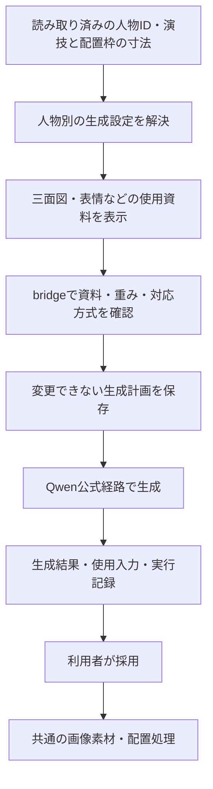

# Qwenで漫画のキャラクター指定と参照資料を接続する設計

状態：人物・背景のあたりへのPNG/JPEG差し替え・サイズコピー・原本保存を実装。Qwenのあたり単位の生成入口・登録人物資料の読み込み・描画PNG参照・ローカルjob接続を実装。モデル実行を伴う本番画面の受け入れ確認は未実施。調査・実装日：2026-09-27。

漫画用の生成は **Qwen-Image-2.1に統一**する。人物を選ぶと、その人物の三面図・表情などの登録資料を
Qwenの画像入力へ接続する。通常操作にモデル選択やタグ形式の切替を設けない。
まず画像参照だけで使えるようにし、Qwen対応の人物LoRAは必要な場合の追加機能とする。
本書は入力解決・生成・結果保存を扱う。ページへの配置は [画像配置・印刷設計](IMAGE_PLACEMENT_PRINT_EXPORT_PLAN.md) に接続する。

ライセンスの確認範囲：モデル利用の条件と、出力画像の権利を分けて扱う。
[公開ライセンス 第1条(i)・第2条](https://huggingface.co/Qwen/Qwen-Image-2.1/blob/main/LICENSE) の条件に加え、
引継ぎ元で確認されたQwen Developersの補足は、出力はlicensed Materialsに含まれず、生成画像等の権利は利用者に残るという内容。
[公式投稿](https://x.com/QwenDevs/status/2101917379785838660)、
[投稿へのリンクと引用を含むdiscussion #40](https://huggingface.co/Qwen/Qwen-Image-2.1/discussions/40)。
本タスクではdiscussion内の引用とリンクを再確認した。X原文は403で取得できておらず、原文を直接再確認したという意味ではない。
補足とモデル利用条件の関係には解釈の未確認部分が残るが、公開ライセンスだけを根拠に生成物も全面商用不可と断定しない。
この未確認部分を人物入力・配置の実装開始を止める条件にはしない。

## 実装した生成入口

- ネーム画面にはペンとレイヤーのバーを常時表示する。「あたりを確認」の隣の「ペイント」、またはバーから選択したあたりを編集できる。
- 「生成」は新しい画像用、「ペイントした画像を参照して生成」は選択中のあたりの可視レイヤーだけを入力画像にする。未反映の描画も使え、確認画面を閉じると描画へ戻る。元のあたりや他のあたりは合成しない。
- 人物は `Figure.refId → Character.localId` で解決する。同名からの推測はしない。登録済み資料の読み込みか、利用者が追加した画像を使う。資料は全体を保持して別々に渡し、資料9枚と先頭キャンバスの最大10枚とする。入力コピーは縦横比を保持して2048px以内に縮小する。
- 通常生成は先頭に白紙キャンバス、描画参照では描画PNGを置く。後続は人物・作画資料。`TextEncodeQwenImage21` の出力latentをそのまま使い、先頭資料の縦横比で出力する。
- `/api/qwen-generation/{submit,reconcile,list}` は独立したQwen jobを扱う。既存labのPython・ComfyUI・モデルを用い、encode/sample/decodeを別プロセスで実行する。文章LLM、ComfyUIサーバー、新しい環境やモデルの取得は不要。`NYAMURU_QWEN_LAB_ROOT` で既存labの位置を指定できる。
- `.local-generation/qwen/<UUID>/` に入力・各段階のログ・CPU/RSS/MPS資源記録・出力を保存する。同じUUIDは再実行せず、入力変更は拒否する。生成結果は確認してPNGを保存し、原稿へは自動採用しない。
- モデルを動かさない契約テストと、分離した画面での入口・描画保持・PNG参照の確認を実施。実際のQwen実行、人物資料の本番台帳からの読み込み、生成品質は実機確認が必要。
- 資料の採用版・役割ごとの編集、LoRA、生成結果の直接採用、途中プレビュー、Hermesからの共通要求経路は後続工程。

## 1. 現在の接続と不足

| 経路 | 既存実装 | この設計で補う部分 |
|---|---|---|
| 人物・資料台帳 | `Figure.refId → Character.localId`、シリーズ人物の `catalog_id`、人物資料の `character_catalog_id` と `source_image` | 人物のQwen用参照設定、資料の採用版、任意のQwen用LoRA |
| Krea2人物レイヤー | 登録画像を候補表示し、代表資料を優先。A/B入力に人物キーを付け、画像を実際に送信 | 人物解決・候補選択・job管理を再利用してQwenへ接続。A/B固定枠は引き継がない |
| Animagineラフ `manga-base` | 3.1固定。人物認識・説明から文章を作り、画像入力なしで生成 | 漫画用の新しい生成操作はQwenへ統一。Animagineの拡張を実装要件にしない |
| Qwen-Image-2.1 | 別labに画像入力を使う実行コードがある | ニャムルの人物・資料台帳とjob管理への接続 |

参照コード：`src/types.ts`、`src/lib/characterReferences.ts`、`src/lib/seriesCatalog.ts`、
`src/lib/layerGeneration.ts`、`src/components/LayerGenerationDialog.tsx`、
`src/lib/panelDraft.ts`、`scripts/krea2_generation.py`、`scripts/nyamuru_local_bridge.py`。

既存の生成履歴は元のモデル情報を保持する。過去のjobを再実行するときに、同じ結果が出るつもりでQwenへ読み替えない。
既存コード・重み・LoRAの削除は一本化設計に含めない。通常の漫画生成UIをQwenに集約する実装として扱う。
Krea2用LoRAやAnimagine用タグ・グレー塗りの定型文を、Qwenの人物・画風設定へ移植しない。

### 本線への引継ぎと実装済みの土台

2026-09-26、「ラブホテル背景コンセプト作成」（`01a09fc7-467a-75e3-b845-f824eb289625`）から
本タスク「Qwen-Image-2.1とアニマジン比較」へ、漫画生成・人物資料・配置・印刷出力の接続を引き継いだ。
元タスクは3Dモデル制作を担当する。同じcheckoutに成果があり、コピーやcherry-pickは不要。
照合開始時のHEADは `f0f2392`、作業ツリーはclean。

- `bf8bcf9` / `ba64209` の印刷設定保存とキャンバス寸法同期を土台にする。
  `pageCanvas.ts`、`MangaCanvas.tsx`、`PageSidebar.tsx` と `finishLayout.ts` で可変寸法とカラー350dpiの既定値を再確認した。
  A4固定座標に戻さず、既存内容・原画画素・cropを保つ。
- 前回の印刷設定はアプリ本体に保存し、シリーズ別プリセットは作らない。作品に適用した設定とは分ける。
  新規作成での確認時期、用途別の表示、カラー350dpiとカスタム値保持も既存実装を継承する。
- 引継ぎ時は汎用配置画像がなかった。現在の共通配置実装は次項に記す。
  Qwen生成結果の採用、塗り足しガイド、見開き出力、表紙、印刷/PDFは後続工程。
- 印刷条件は [24社の調査](PRINTER_REQUIREMENTS_2026-09-25.md) を参照する。
  商品ごとの塗り足し・ページ刻み等を保持し、会社名だけで適合判定しない。60lpiはdpiと別で、既存網点の再トーン化をしない。
- `ba64209` のテスト・実画面確認は引継ぎ元の実績。この照合では再実行していない。
  画像配置計画の「初回調査の根拠」は過去の状態として読み、冒頭の実装済み範囲と現行コードを優先する。

### 共通画像配置の実装範囲

- `manga.image_assets` に原本名、画像形式、画素寸法、バイト長、SHA-256、保存IDを持つ。
  人物・小道具は `figure.artwork`、背景は `panel.background_images` で参照する。
- 人物・小道具のあたりを右クリックして「画像に差し替える…」、コマの背景を右クリックして
  「背景を画像に差し替える…」。右側の各人物カード・背景メニューからも同じ操作ができる。
  あたりの位置とサイズをそのまま使い、枠を追加しない。画像の縦横比が枠と違う場合は余白を残して収める。
  人物ID・アクションを保ち、画像がある間はあたりの絵を描かない。「あたりに戻す」で戻せる。
- 右クリックの「サイズコピー」は作品の保存DPIから枠のmmをpxへ換算し、その寸法の透明PNGと数値を
  クリップボードへ渡す。クリスタでは [ファイル → クリップボードから新規作成](https://www.clip-studio.com/site/gd/csp/manual/userguide/csp_userguide/500_menu/500_menu_file_cpnew.htm)
  で同じpx寸法のキャンバスを作る。通常の「新規」ダイアログの入力欄を自動操作する機能ではない。
  画像クリップボード経由で印刷DPI設定自体が引き継がれる保証はない。px寸法とDPI設定は分けて扱う。
- 人物画像は元の人物枠で移動・拡縮する。背景の操作枠はコマそのものとし、独立した画像のハンドルは出さない。
  原本と切り抜きpxは変更せず、コマ移動・用紙寸法変更でも画像の比率を保つ。
  背景は分割・合体で画素位置を維持するため複数の原本参照を持てるが、画像を差し替えるとそのコマの背景を一つに置き換える。
  コマの画像は所属コマでクリップし、選択で重ね順を変えない。ページ前景の人物画像はコマ枠の上に描く。
- 保存済みの独立画像 `panel.images` / `page.images` は保持し、既存画像だけ編集できる。
  通常の「画像を追加」「ページに画像を配置」は表示せず、あたりの差し替えを入口にする。
- 原本バイト列は再エンコードしない。透明度、ICC、DPI、EXIF等のファイル内情報もそのまま保存する。
  カラーマネジメントされた印刷出力やEXIFの個別端末での見え方まで検証済みという意味ではない。
- 作品フォルダの `.nyamuru/project.json` はmanifest v2、原本は `.nyamuru/assets/<SHA-256>`。
  内容が同じ原本は重複保存せず、ハッシュ検証後にmanifestを最後に原子的更新する。旧inline v1は読み込み可能。
  現在の配置が参照する原本だけをsnapshotへ含め、既存原本ファイルの自動削除はしない。
- ブラウザ内の原本は既存IndexedDBに `original-` IDで保持し、アナログ切抜きの自動整理対象から外す。
  取込中、Undo、別作品への切替で原本が消えることを防ぐ。原本キャッシュの整理UIは後続。
- 初期段階は既存bridge転送API（v1/base64）と96MiB上限を維持し、1画像の取込上限は48MiB。
  ディスク上はbase64埋め込みではない。高解像度の多数ページ向けバイナリ転送・表示proxy・可搬パッケージは別工程。
- 自動テストは原本バイト一致、重複排除、旧形式、欠損・改変検出、保存競合、可変用紙、切り抜き解除を確認。
  実画面では既存の人型あたりへの復帰と、その右クリックからのサイズコピー成功通知を確認。動作確認用の長方形PNGは画面から外した。
  クリスタでの受け取りは未確認。内蔵ブラウザは書込成功を返すものの、クリスタの「クリップボードから新規作成」は有効にならなかった。
  Chromeでの切分けは拡張のファイル読込制限と自動操作の承認拒否により未完了。利用者によるChrome→クリスタの受け取りが次の実機確認点。

## 2. 公式経路に合わせる範囲

**Qwen公式の入力・プロンプト方針とComfyUI公式workflowを基準にする。**
人物台帳との対応付け、保存、使用資料の表示はアプリ側が担当する。
ローカル実装は既存labとつながるComfyUI経路を使い、同じ機能のためにDiffusersの別環境を増やさない。
公式Diffusersの `QwenImage21Pipeline(image=...)` は入力の意味を照合する資料として参照する。

Qwen公式は複数参照を最大10枚まで扱う。公式の編集プロンプト整形指示では、複数画像を
`<image1>`、`<image2>` のように個別に指し、各画像の役割を説明する。
人物の外見は参照へ委ね、変更しない特徴を長く描写し直さない。
[Qwen公式](https://github.com/QwenLM/Qwen-Image-2.1)、
[公式編集プロンプト方針](https://github.com/QwenLM/Qwen-Image-2.1/blob/main/prompt_rewrite/prompts/system_prompt_edit.txt)。

ComfyUIでは [公式編集workflow](https://github.com/Comfy-Org/workflow_templates/blob/main/templates/image_qwen_image_2_1_image_edit.json) を基準にする。
このtemplateは先頭画像を編集対象・出力寸法の基準にする。資料から新しい場面を作るときは
キャンバス役の有無を明示し、出力の幅・高さを別途設定する。設定画の横長比率をそのままコマへ持ち込まない。
Diffusers例とComfyUI templateには既定steps・解像度の違いもあるため、設定値は実行profileごとに記録する。

## 3. 保存するデータ

既存の人物・画像台帳を正本とする。次の名前は追加するデータ型の提案であり、実装済みAPIではない。

### 人物と生成設定の対応 `CharacterGenerationBinding`

- 所有者はシリーズなら `(series_id, character.catalog_id)`。各話だけの人物は `(episode_id, character.localId)`。
  各話からシリーズへ昇格した際は対応IDを移し、旧bindingを二重適用しない。
- `bindingId`、`revision`、`characterDesignRevision` を持つ。人物名は表示用で、同名一致だけで資料を選ばない。
- `references[]` を通常の人物生成入力とする。モデル別の設定表やLoRA必須の入力方式は作らない。
- 任意の `lora`：論理asset ID、ファイルdigest、対応するQwenの版、学習時のtrigger/使用条件、強度、学習資料版。
  未登録でも参照画像で生成できる。追加機能を使う場合だけ、実際にロードできる組合せを確認する。
- `references[]`：既存material/asset ID、`view`、用途（identity / expression / costume / style / pose）、優先順。
  同じ画像が複数の用途を担ってよい。生成時に指定された演技へ合う資料を選び、使用分を確定する。
- 人物の説明・認識結果は資料選択や同定に使う。画像参照用promptへ外見説明を自動で全量展開しない。

基本参照と場面別参照は分ける。三面図を通常資料にし、必要な表情資料を足せる。
`primary_material_catalog_id` は既存の代表画像として引き続き利用し、1枚しか登録できない制約へ変えない。
変更前の資料やLoRAは版を分けて選べるようにし、新しい原画の登録を「LoRA再学習済み」と扱わない。

### 作品と端末の保存先

- シリーズ共通bindingはシリーズroot内の新規sidecar `generation-bindings.json` に保存する案とする。
  既存 `series.omny.yaml` の人物ID・資料IDを参照する。版番号による競合検出とatomic replaceを使う。
- 各話だけのbindingと今回の上書きはアプリ作品データの `manga.character_generation` に保存する案とする。
  既存の保存JSON/YAML、再読込、シリーズ昇格、作品複製、バックアップまで対応させる。
- 公開OMNYの出力ではこの追加フィールドを除き、生成設定の持ち運びはアプリの作品保存・シリーズ保存で行う。
  出力処理は `toOmnyCatalogDocument` / `mangaExportDocument` と照合して実装する。
- 重みの実パス・Python/ComfyUIの場所はbridge側の端末設定だけに持つ。
  portableなbindingはモデルID、revision、digestで照合し、別Macでは対応する重みを再指定できる。
- 各話限定人物は現状のシリーズ画像保存に勝手に昇格させない。
  各話スコープの参照asset保存も追加し、同じresolverへ渡す。対応前のprofileは未対応と表示する。

画像実体は既存の相対path・asset ID・SHA-256を使う。現在の資料取込はPNG化・長辺4096px以内への縮小を行うため、
保存済み資料を「無加工の原稿」と呼ばない。生成入力用のresize/padding/cropはさらに派生物として保存し、元資料を上書きしない。

### Qwen実行設定 `QwenGenerationProfile`

bridge側で管理し、Qwen本体・encoder・VAEのrevision/digest・ComfyUI/workflow版・
参照数・解像度・sampler・steps・CFG・前処理を定義する。
ノードと重みの存在確認、構造上の互換性、実生成の確認済み状態は別々に保持する。
SDXL LoRAをQwenへ渡すようなfamily違いは拒否する。Qwen同士でも版や形式の違うLoRAを
名前だけで互換と判断しない。通常の漫画操作にはモデル選択を出さず、実行版は記録する。

## 4. 人物選択から実行まで

1. `Figure.refId` から人物を解決し、シリーズIDまたは各話IDでbindingを取得する。
   refIdが壊れている、同名人物が複数いる、資料の所有者が違う場合は、その人物の欄に修正内容を表示する。
   旧データの一意な名前一致は移行候補にできるが、生成直前に曖昧な名前へ自動で付け替えない。
2. 「新しい場面」「手元の絵を修正」「人物素材」など目的を指定すると、基本資料を初期選択する。
   表情・衣装・ポーズ資料は場面に合わせて選べる。Qwen用LoRAの追加は詳細設定で扱う。
   参照サムネイルは**実際にencoderへ送る前処理後の画像**も確認できるようにする。
3. bridgeはGPUを使わずに人物ID、資料digest、モデル互換性、ノード、入力方式と枚数を確認する。
   不足時は「こゆきの参照資料が未登録」「指定したQwen用LoRAが見つからない」など該当箇所を示す。
   LoRA未登録は、通常の画像参照生成を妨げるエラーにはしない。
   人物資料を黙って落とす、別人の画像へ差し替える、text-onlyへ自動降格する処理は作らない。
4. `ResolvedGenerationPlan` を確定する。作品snapshotとdigest、対象ページ/コマ/figure位置と配置枠、人物ID・binding版・使用資料と役割・元画像と派生画像のdigest・
   crop/padding/resize・モデルとLoRAのdigest/強度・最終prompt・seed・設定・workflow版を記録する。
   編集用canvas画像、identity参照、pose/structure入力は別項目にする。
5. 実行直前にもdigestを照合し、計画後に入力が変わっていれば新しい計画として作り直す。
   UIだけでなくbridgeが所有者・scope・実画像を検証する。クライアントが任意のpathやworkflowを送る形にはしない。
6. job IDと入力・workflow hashを保存してから送信する。既存Krea2のimmutable job/intent方式を共通化する。
   結果不明の送信を自動再送せず、履歴確認で復旧する。

UIには通常「こゆき／三面図＋眠そうな表情資料」のように、実際に使う情報を表示する。
詳細を開くとQwenの版・任意のLoRA・prompt・画像前処理まで見える。
背景・小道具など資料が任意の生成は参照なしでも使える。登録キャラクターの資料欠落とは区別する。
JSON・ノード名・内部hashは通常の制作操作へ持ち込まない。

Hermes等からの依頼も、同じ人物ID・資料指定・場面指示でこのprepare/submit処理を使う設計とする。
画像ファイル名を自由文から推測する別経路は設けない。現在の外部呼出し口への実装は別工程。

## 5. Qwenへ渡す入力

画像の順序とroleからprompt内の画像番号を同時に生成する。単一入力と複数入力を区別する。
公式ComfyUIの `TextEncodeQwenImage21` 系の入出力と画像条件を保って接続し、
SDXLの `VAEEncode → KSampler` だけのimg2img経路へ置き換えない。

例えば三面図と表情資料の2枚なら、それぞれを `<image1>`、`<image2>` と対応付け、
同じ1人の人物資料であること、使う要素、今回の演技を指定する。
顔や服の詳細を全部文章へ展開する代わりに、参照の人物性・頭身・筆致を保持する指示を添える。
画像を並べ替えたらpromptも作り直す。新しい場面では設定画の並びを出力構図として模倣させない。

三面図や表情集は全体を渡すことを基本とし、必要な場合にだけ入力用の切り出しを選ぶ。
顔9方向を毎回追加する固定構成にはしない。参照は目的に必要なものを使い、全資料を毎回ロードしない。
利用者が別途構図参照として指定した手描きラフや3D画像は構図・poseの参照、修正対象の絵はcanvasとして役割を分ける。
ネームの「あたり」画像を、この構図・pose参照へ自動で割り当てない。
IP-AdapterやSDXL用ControlNetの導入を前提にせず、Qwenの画像条件として渡す。

プロンプト整形を使う場合も資料と役割を維持し、ユーザーの演技や筆致を変更しない。
Qwen公式のPEは別モデルであり、通常の短いprompt組立てに追加モデルの常駐を必須にしない。
SDXL用こゆきLoRAは流用せず、Qwen対応LoRAの登録・ロード可否は対応形式と実行環境で個別確認する。

### 複数人物

同じ人物の三面図＋表情資料は「2人」ではない。人物数と画像数を別々に数える。
Qwen公式の上限10枚の範囲で、各画像と人物IDを対応付ける。実際のメモリ負荷は別途測定する。
上限超過時に末尾の人物・画像を黙って捨てたり、複数人物を無断で1枚の資料へ合成したりしない。

人物ごとの配置、表情、相手との視線・接触をpromptで対応付ける。
複数の人物LoRAを全体にロードするだけで、人物ごとの領域を固定できるとは扱わない。
単独人物経路の完了を、複数人物の接触・視線・衣装分離まで検証済みという意味にはしない。

## 6. 筆致と資料の版

作品・人物の保存済み方針を入力へ反映する。こゆきはモノクロ原画を基準とし、歪で少し震えながらも
しっかりした線、不均一な線幅、デフォルメと単純なシルエットを保つ。
ハッチングは影と黒ベタのざらつきに使う。整った輪郭・均一な線幅・ハッチング除外を共通の品質指定にしない。
グレー塗りの禁止と線のアンチエイリアスを区別し、印刷用の二値化は出力工程で扱う。

外見は人物の基準資料、演技は `Figure.action`、場面はコマ情報、描き方は保存済みの作画方針から取る。
互いに競合する場合は今回の明示指示を優先し、意図が判別できない矛盾は該当項目を示す。
「脇を締めてカップを持つ」はその場面の演技として保存し、全女性や全場面の固定ルールにはしない。

このMacにある既存のこゆきLoRAはAnimagine 4.0 Zero用で、Qwenには流用しない。
Qwen用こゆきLoRAの学習・ロード検証は未実施。新しい原画の登録を、LoRAの更新として表示しない。
いつも使うpromptは
こゆき共通設定（ローカル資料 `../../nyamuruテスト用シリーズフォルダ/character_data/できたやつ/koyuki/PROMPT_DESIGN.md`、配布対象外） を参照する。
試行結果や端末状態を、これらの再利用用promptへ追記しない。

## 7. 実行記録と画像配置との接点

### あたり・演技・画像寸法の契約

あたりは生成物を置く位置・サイズの枠として扱う。あたり画像を再解析して演技・ポーズを推定しない。
にゃむるが画像やト書きから読み取り、利用者が確認・編集した `Figure.action` とコマの場面情報を生成へ渡す。
現行 `layerGeneration.ts` も演技を `Figure.action`、相対配置を `bbox` から作っており、この役割分担を継承する。

接続は **読み取り済みの演技＋人物資料＋あたりの寸法 → Qwen生成 → 元の位置へスケールを合わせて採用** とする。
生成中にあたりが移動・削除された場合に備え、計画の対象と版を照合し、古い位置へ無断で貼り戻さない。

次の3つを別々に記録する。

- `placementBoxMm`：元ページ/コマ上のあたりの位置と寸法。正規化した座標を使う場合も基準ページ寸法を保持する。
- `canvasSizePx`：Qwenへ指定する出力画像全体の幅・高さ。配置枠の縦横比を基に対応寸法へ調整する。
- `contentRectPx`：画像内で配置の基準とする人物・内容の範囲。未確認なら画像全体として扱い、人物の範囲を推測で確定しない。

出力画像の縦横比やサイズが合っていても、余白が違えば人物の大きさは合わない。
基本配置は縦横比を保って枠へ収め、画像全体と人物の占有範囲を区別して確認・調整できるようにする。
切り抜く場合も原画像を残し、配置transform/cropとして保存する。実効解像度は実際の画素と配置寸法から出力側で算出する。
背景込み生成後の切抜きと人物単独生成の使い分け、および人物占有範囲の自動取得方法は未決。
この選択を保存形式の固定前提にせず、まず原画像・配置枠・内容範囲を保持できる契約を作る。

### 実行と採用

生成結果にはjob ID、入力計画、PNG原本、寸法、alpha、成功/失敗、所要時間を残す。
CPU使用率・RSS・MPS使用量は項目を分け、計測間隔と観測peakを記録する。重複し得るメモリ量を足さない。
途中previewはbackendが対応するときの低解像度の派生物とし、完成画像と区別する。
preview方式・頻度・メモリ影響を実測するまでは「負荷が小さい」と表示しない。
失敗時に取得できた画像も失敗状態とともに閲覧できるようにする。

既存のmanaged/external-sharedの所有権を守り、外部8080を勝手に停止しない。
生成可否は既存の実行管理へ接続し、この設計のために新しい常駐サービスを増やさない。

採用前は生成jobの出力。採用時に共通の画像素材として登録し、出自を `generated`、参照元をjob IDにする。
3D出力・Clip Studio編集・外部PNG等と同じ配置操作へ渡す。キャラクター資料フォルダへ結果を自動で戻さない。
採用した画像はキャッシュから独立して保存し、キャッシュ削除で作品から消えないようにする。
配置・拡縮・crop・印刷寸法は配置側の責任とし、生成元PNGを変更しない。
Clip Studio編集で別版になった画像も親assetを記録し、「AIの生成原本」と取り違えない。

## 8. 実装順と完了条件

1. **共通画像配置と保存**：PNG/JPEGを原本保持で `ImageAsset` / `PlacedImage` へ取り込み、選択したあたりへ比率を保って配置する。
   3D・クリスタ・生成画像が同じ経路を使えるようにし、移動・拡縮・crop・Undo・作品保存と再読込を確認する。
   動的なページ寸法と `finishLayout` を使う。PSDは原本保持＋保存済み合成画像の配置を次に追加し、完全なレイヤー編集とは分ける。
2. **人物binding・保存・prepare**：ID解決、参照資料の版・役割・順序、読み取り済み演技、配置枠、Qwen入力確認、使用資料UI。
   同名・改名・各話/シリーズ・資料差替え・再読込・公開OMNY除外を確認。モデルを動かさず接続不足を発見できること。
3. **Qwenから元位置へ採用**：公式ComfyUI経路を人物台帳・job管理へ接続。
   参照1枚と三面図＋表情の2枚で、実入力・人物・筆致・頭身・所作を確認し、結果を共通配置へ渡す。
   採用・取消・再読込・キャッシュ削除後の保持まで確認する。通常の漫画生成UIをQwenへ集約する。
4. **構図・複数人物**：明示された手描き/3Dの構図参照、人物ごとの資料、修正対象canvasを同じQwen経路で扱う。
   画像の役割、人物混同、視線・接触を実画像で確認し、CPU・メモリ・時間を記録する。
5. **紙面から出力**：配置計画に沿い、塗り足し/安全余白ガイド、綴じと見開き、出力専用描画、画像/PDF出力を実装する。
   まず正しい物理寸法とページ順のモノクロ出力を確認し、入稿商品の条件・表紙・PDF/X等を段階的に検証する。
   設定値の保存を出力対応済みの根拠にしない。

任意のQwen用LoRAは、参照だけでは不足する項目を確認した場合の別作業とする。基本生成の完成条件にはしない。

実装時の検証は、対応IDや資料が違えば送信しないこと、Qwenのgraphが公式経路に沿うこと、
選択した画像のdigestと使用画像のdigestが一致すること、既存生成履歴を壊さないことを重点にする。
静的な接続確認と、生成された人物が原画に似ているかの評価は別の完了項目とする。

過去の喫茶店テストは、参照入力の渡し方が適切でなかったというユーザーの判断により性能比較から除外する。
失敗画像・記録は履歴として保持するが、そのノイズ・頭身・筆致をQwen本来の能力の限界として引用しない。
評価は公式方式に沿う実入力・前処理・promptが確認できる新しい試行で行う。

今回の成果は設計書とプロンプト資料の整理まで。人物データの登録変更、学習、依存追加、推論、配置実装は実施していない。
